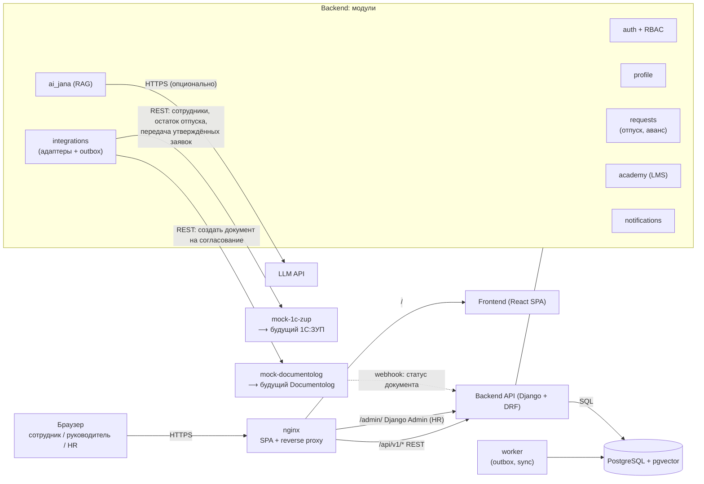
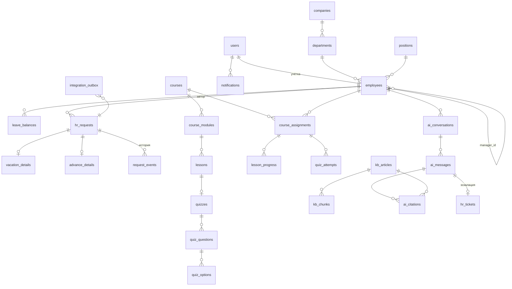
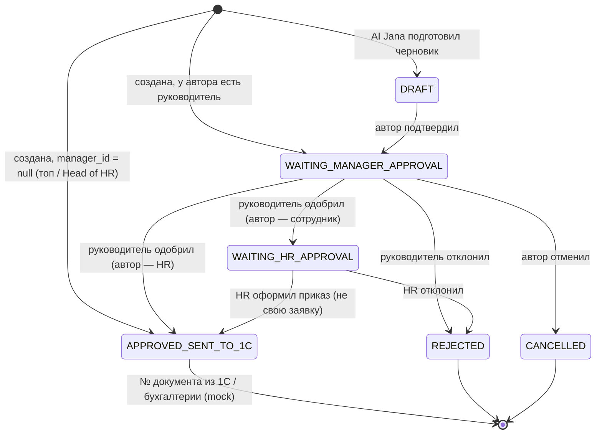
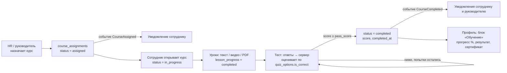
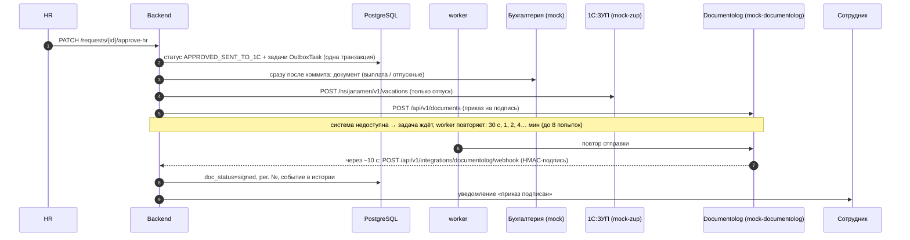
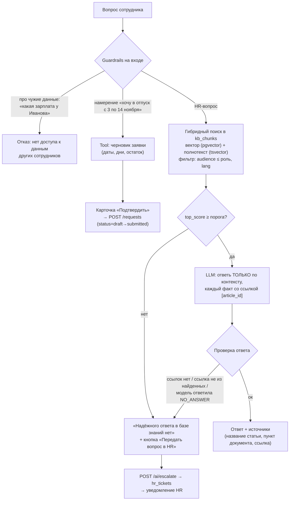
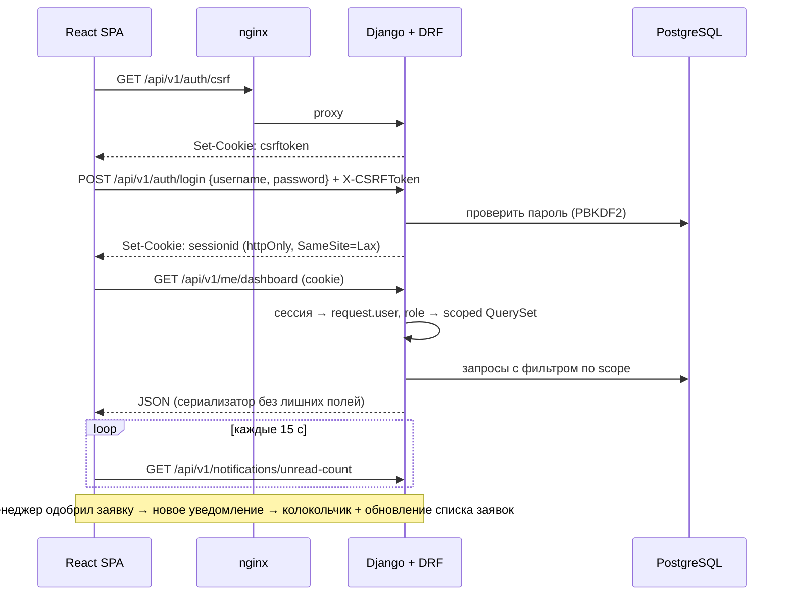

# JanaМен — архитектура прототипа (Jana Post × Terricon Valley, Challenge 02 «Digital HR»)

Единая HR-платформа сотрудника: вход и роли → личный кабинет → заявки (отпуск / аванс) → статусы и уведомления → Jana Academy (LMS) → AI Jana (HR-ассистент по базе знаний).
Формат: адаптивный веб-сайт (SPA), запуск одной командой `docker compose up`.

Критерии жюри, под которые заточена архитектура: сквозной сценарий 30%, UX 20%, **архитектура 20%** (роли, данные, API, интеграции), **AI 15%**, **Academy 10%**, защита 5%.

---

## 1. Технологический стек

| Слой | Технология | Почему |
|---|---|---|
| Frontend | React 18 + TypeScript + Vite, React Router, собственный CSS с токенами (светлая/тёмная тема) | быстрый старт, адаптивность mobile-first |
| Данные на фронте | TanStack Query, клиент сгенерирован из OpenAPI (`openapi-typescript`) | типы API всегда совпадают с backend |
| Локализация | `react-i18next`, файлы `ru.json` / `kk.json` | переключатель RU/KZ (бонус) |
| Backend | Python 3.12 + Django 5.2 LTS + Django REST Framework, drf-spectacular (OpenAPI, `/api/docs`), тема админки django-unfold | готовые auth, ORM, миграции, удобная Django Admin для HR-контента |
| Аутентификация | Django session auth (cookie `sessionid`, httpOnly) + CSRF-токен в заголовке `X-CSRFToken` | фронт и API на одном домене; права проверяет сервер |
| БД | PostgreSQL 16 + расширение `pgvector` (`pgvector.django.VectorField`) | одна БД и для данных, и для векторного поиска |
| AI | LLM через абстракцию `LLMProvider` (Claude API; ключ в `.env`) + локальные эмбеддинги `multilingual-e5-small` | RU/KZ, работает без внешнего сервиса эмбеддингов |
| Фоновые задачи | контейнер `worker`: management-команда `run_worker` (outbox, синхронизация с mock 1С) | без Celery и брокера |
| Уведомления | polling `GET /notifications/unread-count` раз в 10 с: при новом `latest_id` фронт обновляет заявки и уведомления (позже SSE через ASGI) | просто и надёжно для демо |
| Внешние системы | контейнеры `mock-1c-zup` и `mock-documentolog` (маленькие HTTP-сервисы) | реальная HTTP-граница, заменяется на боевые API |
| Инфраструктура | Docker Compose, Nginx (раздаёт фронт + проксирует `/api`) | одна команда запуска |

---

## 2. Общая схема (контейнеры)



**Где подключаются 1С:ЗУП и Documentolog:** только через модуль `integrations` (см. §7). Остальной код вызывает интерфейсы `HRISProvider` и `DocFlowProvider` и не знает, mock это или боевая система. Замена = новый адаптер + переменная окружения `HRIS_PROVIDER=zup`.

---

## 3. Ролевая модель и права (проверка на сервере)

| Роль | Видит | Может |
|---|---|---|
| `employee` | свой профиль, свои заявки, свои курсы, свои уведомления, AI Jana | создать / отменить свою заявку, проходить курсы, задать вопрос AI, эскалировать в HR |
| `manager` | всё как employee + **только прямых подчинённых** (`employees.manager_id = me`) и их заявки / прогресс обучения | согласовать / отклонить заявку подчинённого, назначить курс своей команде |
| `hr_admin` | все сотрудники, все заявки, вся Academy, база знаний, эскалации | финальное утверждение, назначение курсов, CRUD курсов и статей БЗ, ответы на эскалации |

Как это работает технически:

1. **Аутентификация** — `GET /auth/csrf` (ставит cookie `csrftoken`) → `POST /auth/login` → Django-сессия в httpOnly cookie `sessionid`. Роль хранится в `User.role`.
2. **Авторизация на уровне эндпоинта** — DRF permission-классы `IsManager`, `IsHR` (`core/permissions.py`).
3. **Авторизация на уровне данных (главное)** — все ViewSet'ы берут данные через scoped QuerySet (`org/scopes.py`):
   ```python
   def visible_employees(user):
       qs = Employee.objects.all()
       if user.role == Role.HR_ADMIN: return qs
       if user.role == Role.MANAGER:  return qs.filter(Q(id=user.employee_id) | Q(manager_id=user.employee_id))
       return qs.filter(id=user.employee_id)
   ```
   `get_queryset()` заявок, профилей, прогресса фильтрует по этому scope. Чужой `id` в URL → `404` (не `403`, чтобы не раскрывать существование записи).
4. **Кадровые данные read-only** — у API профиля нет `PUT/PATCH` на поля из 1С. Изменить их может только синхронизация из `HRISProvider`.
5. **Аудит** — все изменения статусов и действия HR пишутся в `audit_log`.
6. Фронтенд прячет недоступные разделы (route guards по роли), но это только UX — защита на сервере.

Демо сценария 3: руководитель открывает `/api/v1/employees/{id чужого сотрудника}` → `404`; это стоит показать жюри (Swagger или DevTools).

---

## 4. База данных

### 4.1 ER-диаграмма



### 4.2 Таблицы

**Оргструктура и пользователи** (источник истины — 1С:ЗУП, у нас копия только для чтения)

| Таблица | Ключевые поля |
|---|---|
| `users` | `id`, `login`, `password_hash`, `role` (`employee`/`manager`/`hr_admin`), `employee_id`, `locale` (`ru`/`kk`), `is_active` |
| `companies` | `id`, `name_ru`, `name_kk`, `external_id` |
| `departments` | `id`, `company_id`, `name_ru`, `name_kk`, `parent_id`, `external_id` |
| `positions` | `id`, `title_ru`, `title_kk`, `external_id` |
| `employees` | `id`, `full_name`, `company_id`, `department_id`, `position_id`, `manager_id → employees`, `hire_date`, `email`, `external_id` (табельный № в ЗУП), `source` (`mock_zup`), `synced_at` |
| `leave_balances` | `employee_id`, `leave_type` (`annual`), `days_total`, `days_used`, `days_reserved`, `as_of`, `synced_at` |

**HR-заявки**

| Таблица | Ключевые поля |
|---|---|
| `hr_requests` | `id`, `number` (`ZR-2026-0001`), `type` (`vacation`/`advance`), `employee_id`, `status`, `current_approver_id`, `created_at`, `updated_at`, `external_doc_id` (id в Documentolog), `external_zup_id` |
| `vacation_details` | `request_id`, `date_from`, `date_to`, `days`, `vacation_type` (`annual`/`unpaid`), `comment` |
| `advance_details` | `request_id`, `amount`, `currency` (`KZT`), `reason`, `pay_date` |
| `request_events` | `id`, `request_id`, `from_status`, `to_status`, `actor_id`, `comment`, `created_at` — **история заявки** |

**Jana Academy (LMS)**

| Таблица | Ключевые поля |
|---|---|
| `Course` | `title_ru`, `title_kk`, `description_ru/kk`, `cover_emoji`, `duration_min`, `is_published` |
| `CourseModule` | `course`, `order`, `title` |
| `Lesson` | `module`, `order`, `title`, `type` (`text` — материал из блоков / `quiz` — тест), `duration_min` |
| `LessonBlock` | `lesson`, `order`, `type` (`heading`/`text`/`note`/`image`/`video`/`file`), `text` (текст или подпись), `file` (загрузка в `/media/`), `url` (YouTube или внешнее видео) — урок собирается из блоков, как в конструкторе сайта |
| `Quiz` | `lesson` (1:1), `pass_score` (%), `max_attempts` (0 — без ограничений) |
| `Question` | `quiz`, `order`, `type` (`single`/`multiple`/`ordering`/`fill_blanks`), `text` (для `fill_blanks` — с пропусками `{{1}}`, `{{2}}`), `points`, `explanation` |
| `Option` | `question`, `text`, `is_correct` (single/multiple), `correct_position` (ordering — место 1..N; fill_blanks — номер пропуска, пусто — лишнее слово). **Не отдаются на фронт до проверки** |
| `CourseAssignment` | `course`, `employee`, `assigned_by`, `due_date`, `status` (`assigned`/`in_progress`/`completed`/`failed`), `progress_pct`, `score` (текущее прохождение), `best_score`, `cycle` (номер прохождения), `started_at`, `completed_at` — **видно в профиле** |
| `LessonProgress` | `assignment`, `lesson`, `cycle`, `completed_at` |
| `QuizAttempt` | `assignment`, `quiz`, `cycle`, `answers` (JSON), `details` (результат по вопросам), `score`, `passed` |

**AI Jana и база знаний**

| Таблица | Ключевые поля |
|---|---|
| `kb_articles` | `id`, `slug`, `title`, `body_md`, `lang`, `category` (отпуск, аванс, больничный, командировки…), `audience` (`all`/`manager`/`hr`), `source_ref` (напр. «Правила внутреннего трудового распорядка, п. 4.2»), `version`, `updated_at` |
| `kb_chunks` | `id`, `article_id`, `chunk_idx`, `text`, `embedding vector(384)`, `tsv tsvector` (полнотекстовый поиск) |
| `ai_conversations` | `id`, `user_id`, `created_at` |
| `ai_messages` | `id`, `conversation_id`, `role` (`user`/`assistant`), `text`, `answer_status` (`answered`/`no_answer`/`refused`), `top_score`, `latency_ms` |
| `ai_citations` | `message_id`, `article_id`, `chunk_id`, `score` |
| `hr_tickets` | `id`, `employee_id`, `question`, `source_message_id`, `status` (`open`/`answered`/`closed`), `hr_answer`, `assignee_id` |

**Уведомления, интеграции, аудит**

| Таблица | Ключевые поля |
|---|---|
| `notifications` | `id`, `user_id`, `type` (`request_status_changed`, `course_assigned`, `course_completed`, `hr_ticket_answered`), `title`, `body`, `link` (`/requests/123`), `is_read`, `created_at` |
| `integration_outbox` | `id`, `target` (`zup`/`documentolog`), `event_type`, `payload jsonb`, `status` (`pending`/`sent`/`failed`), `attempts`, `last_error` |
| `audit_log` | `id`, `actor_id`, `action`, `entity`, `entity_id`, `diff jsonb`, `created_at` |

Индексы: `employees(manager_id)`, `hr_requests(employee_id, status)`, `notifications(user_id, is_read)`, `kb_chunks` — HNSW по `embedding` и GIN по `tsv`.

---

## 5. Backend

### 5.1 Структура (модульный монолит, Django apps)

```
backend/
  config/          settings.py, urls.py (/api/v1/*, /admin/, /api/docs)
  core/            permissions.py (IsManager, IsHR), events.py (шина доменных событий), exceptions.py
  accounts/        User (role, locale, employee), вход/выход/csrf, /me
  org/             Company, Department, Position, Employee, LeaveBalance, scopes.py, /me/profile, /team
  hr_requests/     HrRequest, VacationDetails, AdvanceDetails, RequestEvent, state_machine.py, services.py
  notifications/   Notification, подписчики на доменные события
  academy/         Course, Module, Lesson, Quiz..., Assignment, LessonProgress, QuizAttempt, grading.py
  ai_jana/         KbArticle, KbChunk, AiMessage, HrTicket, retriever.py, guardrails.py, llm_provider.py
  integrations/
    ports.py                     HRISProvider, DocFlowProvider (интерфейсы)
    adapters/mock_zup.py         ↔ mock-1c-zup
    adapters/mock_documentolog.py ↔ mock-documentolog
    models.py                    IntegrationOutbox
    management/commands/run_worker.py
    views.py                     POST /integrations/documentolog/webhook
  */management/commands/seed.py  тестовые пользователи, заявки, курсы, 15–20 статей БЗ
```

Каждый app: `views` (DRF ViewSet, HTTP) → `services` (бизнес-логика + проверка прав) → `models`/QuerySet (с учётом scope). Apps общаются через доменные события (`core/events.py`), а не прямыми вызовами:

```
RequestStatusChanged  → notifications (сотруднику), integrations (outbox при approved)
CourseAssigned        → notifications (сотруднику)
CourseCompleted       → notifications (сотруднику + руководителю), обновление профиля
HrTicketCreated       → notifications (HR)
```

### 5.2 Жизненный цикл заявки (state machine)



Маршрут адаптивный: зависит от `manager_id` и роли автора, поэтому HR никогда не обрабатывает заявку сам себе. Правила в `state_machine.py`: «Одобрить» — только назначенный руководитель автора; «Оформить приказ» — только HR и только чужую заявку из `WAITING_HR_APPROVAL`; валидация (даты отпуска в будущем, дней ≤ остатка из `leave_balances`, аванс ≤ лимита). Каждый переход = запись в `request_events` + событие `RequestStatusChanged`.

### 5.3 REST API (`/api/v1`)

| Метод | Путь | Роль | Назначение |
|---|---|---|---|
| GET | `/auth/csrf` | все | выдать CSRF-cookie |
| POST | `/auth/login`, `/auth/logout` | все | вход / выход (Django-сессия) |
| GET | `/me` | все | текущий пользователь + роль + доступные разделы |
| GET | `/me/profile` | все | ФИО, компания, должность, подразделение, руководитель, дата приёма, остаток отпуска |
| GET | `/me/dashboard` | все | одним запросом: профиль, быстрые сервисы, последние заявки, курсы, непрочитанные уведомления (сценарий 1) |
| GET/POST | `/requests` | все | мои заявки (у manager/HR — `?scope=team` / `?scope=all`) / создать |
| GET | `/requests/{id}` | по scope | карточка + история `events` |
| PATCH | `/requests/{id}/approve-manager` | назначенный руководитель автора | «Одобрить» → HR или сразу в 1С (если автор — HR) |
| PATCH | `/requests/{id}/approve-hr` | HR, не автор | «Оформить приказ» → `APPROVED_SENT_TO_1C` |
| PATCH | `/requests/{id}/reject`, `/cancel`, `/submit` | по state machine | отклонить (с комментарием) / отменить / отправить черновик |
| GET | `/team` | manager | моя команда (только прямые подчинённые) |
| GET | `/team/{employee_id}` | manager | разрешённые данные подчинённого |
| GET | `/academy/courses`, `/academy/courses/{id}` | все | каталог, структура курса + моё назначение |
| POST | `/academy/courses/{id}/enroll` | все | записаться самому |
| GET | `/academy/assignments?scope=my\|team\|all` | все / manager / HR | мои курсы / обучение команды / все |
| GET | `/academy/assignments/{id}` | владелец / manager / HR | курс со статусами уроков (`completed`/`available`/`locked`) и состоянием тестов |
| GET | `/academy/assignments/{id}/lessons/{lesson_id}` | владелец | материал урока; для теста — вопросы без правильных ответов |
| POST | `/academy/assignments/{id}/lessons/{lesson_id}/complete` | владелец | отметить урок |
| POST | `/academy/assignments/{id}/quizzes/{quiz_id}/attempts` | владелец | `{answers}` → оценка на сервере, разбор |
| POST | `/academy/assignments` | manager (своим) / HR | `{course_id, employee_ids, due_date}` → назначить + уведомление |
| POST | `/ai/ask` | все | вопрос AI Jana → `{answer, status, citations[], suggested_action}` |
| POST | `/ai/escalate` | все | передать вопрос в HR → `hr_tickets` |
| GET | `/notifications`, `/notifications/unread-count` | все | центр уведомлений; `unread-count` → `{count, latest_id}` для polling |
| GET | `/requests/vacation-calendar` | все (только свои) | занятые дни отпуска (на согласовании и утверждённые) для календаря |
| POST | `/notifications/{id}/read`, `/notifications/read-all` | все | прочитано |
| — | `/admin/` (Django Admin, вне `/api/v1`) | hr_admin | курсы, уроки, тесты, статьи БЗ, сотрудники, лог интеграций |
| GET | `/hr/tickets`, POST `/hr/tickets/{id}/answer` | hr_admin | эскалации из AI Jana (в SPA) |
| POST | `/hr/sync/zup` | hr_admin | ручной запуск синхронизации с (mock) 1С:ЗУП |
| POST | `/integrations/documentolog/webhook` | подпись HMAC | статус документа из Documentolog |

Единый формат ошибок: `{"error": {"code": "REQUEST_INVALID_TRANSITION", "message": "...", "message_kk": "..."}}`.

---

## 6. Jana Academy (LMS)



**Типы вопросов и проверка (`academy/grading.py`):**

| Тип | Как отвечает сотрудник | Ответ в API | Баллы |
|---|---|---|---|
| `single` | один вариант | `id` | всё или ничего |
| `multiple` | несколько вариантов | `[id, …]` | (верные − лишние) / все верные, не меньше 0 |
| `ordering` | перетаскивает варианты в правильном порядке | `[id в выбранном порядке]` | доля позиций на своих местах |
| `fill_blanks` | перетаскивает слова в пропуски внутри текста (есть лишние слова) | `{"1": id, "2": id}` | доля верно заполненных пропусков |

- Уроки открываются по порядку: следующий доступен после всех предыдущих (проверяет сервер).
- Тест засчитывается при `score ≥ pass_score`; попытки ограничены `max_attempts`. Правильные ответы и пояснения сервер показывает только после сдачи или когда попытки закончились.
- Варианты `ordering` и `fill_blanks` перемешиваются стабильно для каждого сотрудника (не прыгают при обновлении страницы).
- `progress_pct` = пройденные уроки / все уроки; при 100% → `completed`, `score` = лучший результат по тестам курса.
- Назначение: HR — любому, руководитель — только своим подчинённым; сам сотрудник может записаться из каталога.
- Повторное прохождение (`POST /academy/assignments/{id}/restart`): сотрудник может перепройти сданный курс; несданный курс назначает повторно HR или руководитель (сотрудник получает уведомление, руководителю приходит уведомление о несданном курсе). Каждое прохождение — новый `cycle`: прогресс и попытки считаются заново, история и `best_score` сохраняются.
- Связь с профилем: `/me/profile` → `learning[]`, `/me/dashboard` → `courses[]`; руководитель видит обучение подчинённого в `/team/{id}` и `/academy/assignments?scope=team`, но не проходит курс за него.
- Контент редактируется в Django Admin (тема django-unfold): курс → модули → «конструктор урока» (блоки перетаскиваются, есть превью картинок и загрузка файлов до 200 МБ) → тест → вопросы → варианты. Файлы хранятся в томе `media`, nginx отдаёт их по `/media/` с запретом скриптов (CSP).
- Seed (`core/demo_courses.py`): «Адаптация в Jana Post», «Информационная безопасность» (в каждом тесте все 4 типа вопросов) и «Клиентский сервис в отделении» для записи из каталога.

---

## 7. Интеграции: 1С:ЗУП, Documentolog, бухгалтерия

Код — в `backend/integrations/`, заглушки внешних систем — в `mocks/`. Остальной код знает только интерфейсы (порты), поэтому замена заглушки на боевую систему — это смена URL и ключей в `.env`.

### 7.1 Порты и адаптеры (`integrations/ports.py`, `adapters.py`)

| Порт | Методы | Адаптеры | Настройка |
|---|---|---|---|
| `HRISProvider` (1С:ЗУП) | `fetch_snapshot()` → компания, подразделения, должности, сотрудники, остатки отпуска; `push_vacation(payload)` → № документа «Отпуск» | `ZupHttpAdapter` (заглушка `mocks/zup` или HTTP-сервис ЗУП `/hs/janamen/v1`), `InMemoryZupAdapter` (тесты) | `HRIS_PROVIDER`, `ZUP_BASE_URL`, `ZUP_USER`, `ZUP_PASSWORD` |
| `DocFlowProvider` (Documentolog) | `create_document(payload, callback_url)` → id документа; результат приходит обратным вызовом | `DocumentologHttpAdapter` (заглушка `mocks/documentolog` или API Documentolog), `InMemoryDocflowAdapter` | `DOCFLOW_PROVIDER`, `DOCUMENTOLOG_BASE_URL`, `DOCUMENTOLOG_TOKEN`, `DOCUMENTOLOG_WEBHOOK_SECRET` |
| `AccountingProvider` (бухгалтерия) | `send_request(payload)` → № документа | `MockAccountingAdapter` (в процессе) | `ACCOUNTING_PROVIDER` |

**Контракт HTTP-сервиса 1С:ЗУП** задаём мы (описан в `mocks/zup/server.py`): 1С-разработчик публикует в ЗУП HTTP-сервис с теми же адресами — и backend работает с ним без изменений кода.

### 7.2 Кадровые данные из 1С:ЗУП (`integrations/zup_sync.py`)

- Запуск: при старте backend (`sync_zup --trigger startup`, сбой не останавливает запуск), командой `manage.py sync_zup` и кнопкой «Синхронизировать с 1С:ЗУП сейчас» в Django Admin.
- Сопоставление по кодам 1С: табельный номер, коды подразделений и должностей. Обновляются ФИО, подразделение, должность, руководитель, дата приёма, остатки отпуска. Учётные записи не создаются, сотрудники, которых нет в ЗУП, не удаляются.
- Каждый запуск — запись `SyncRun` (что создано / обновлено / без изменений, ошибка).

### 7.3 Утверждённые заявки → внешние системы (outbox, `integrations/outbox.py`)



- **Почему outbox:** утверждение заявки не падает, если внешняя система недоступна. Задачи создаются в той же транзакции, что и утверждение, поэтому не теряются; worker (`manage.py run_worker`, отдельный контейнер) отправляет их с повторами. Двойная отправка исключена: строка задачи блокируется (`select_for_update(skip_locked)`), заглушки идемпотентны по номеру заявки.
- **Маршрут:** отпуск → бухгалтерия, 1С:ЗУП (документ «Отпуск»), Documentolog (приказ); аванс → бухгалтерия, Documentolog.
- **Статус заявки не меняется** (остаётся «Утверждено / Передано в 1С»): результаты пишутся в поля `external_accounting_id`, `external_zup_id`, `external_doc_id`, `doc_status`, `doc_registration_number`, событиями в истории и уведомлениями. Так фронтенд не нужно менять при подключении новых систем.
- **Обратный вызов Documentolog** проверяется HMAC-SHA256 подписью тела (`X-Documentolog-Signature`), повторный вызов с тем же статусом игнорируется. Приказ отклонён → уведомление сотруднику и HR.
- **Админка:** «Очередь отправок» (статус, попытки, ошибка, кнопка «Отправить повторно») и «Синхронизации с 1С:ЗУП».

### 7.4 Подключение боевых систем

1. 1С:ЗУП: опубликовать HTTP-сервис по контракту `mocks/zup/server.py`, в `.env` указать `ZUP_BASE_URL`, `ZUP_USER`, `ZUP_PASSWORD`.
2. Documentolog: шаблоны приказов `vacation_order`, `advance_order`; в `.env` — `DOCUMENTOLOG_BASE_URL`, `DOCUMENTOLOG_TOKEN`, `DOCUMENTOLOG_WEBHOOK_SECRET`; в Documentolog — адрес обратного вызова `https://<домен>/api/v1/integrations/documentolog/webhook`. Если формат API Documentolog отличается от заглушки — меняется только `DocumentologHttpAdapter`.
3. Убрать сервисы `mock-zup` и `mock-documentolog` из compose.

---

## 8. AI Jana (RAG с защитой от выдумок)

### 8.1 Пайплайн ответа



### 8.2 Ключевые правила

- **Только база знаний.** Системный промпт запрещает отвечать вне контекста; модель обязана вернуть маркер `NO_ANSWER`, если контекст не покрывает вопрос. Сервер дополнительно проверяет, что все `[article_id]` в ответе есть среди найденных фрагментов.
- **Порог уверенности** (`AI_MIN_SCORE`) — ниже порога LLM вообще не вызывается → сценарий 6 детерминирован.
- **Никаких чужих данных.** В контекст LLM попадают только статьи БЗ и данные **текущего** пользователя (остаток отпуска, его заявки) — через внутренние функции, которые используют тот же `AccessScope`. Имена других людей в контекст не передаются.
- **AI не принимает решений** — он только готовит черновик заявки; отправляет её сотрудник, утверждают люди.
- **Режим без ключа LLM** (`LLM_PROVIDER=extractive`): ответ = лучший фрагмент статьи + ссылка. Демо работает даже без интернета.
- Каждый ответ логируется (`ai_messages`, `ai_citations`, `top_score`) — HR видит, какие вопросы ушли без ответа, и дополняет БЗ.
- Seed БЗ: 15–20 статей (ежегодный отпуск, перенос отпуска, неоплачиваемый отпуск, аванс и сроки выплаты, больничный, командировки, справка с места работы, график работы, удалёнка, адаптация, обучение, ДМС, увольнение, контакты HR и т.д.), RU + часть на KZ.

---

## 9. Frontend и связь с backend

### 9.1 Маршруты и меню по ролям

| Маршрут | Экран | employee | manager | hr_admin |
|---|---|:-:|:-:|:-:|
| `/login` | вход + выбор языка | ✓ | ✓ | ✓ |
| `/` | Главная: профиль, быстрые сервисы («Отпуск», «Аванс», «Спросить AI»), мои заявки, обучение, уведомления | ✓ | ✓ | ✓ |
| `/profile` | профиль (read-only, пометка «данные из 1С:ЗУП») + блок обучения | ✓ | ✓ | ✓ |
| `/requests`, `/requests/new?type=vacation`, `/requests/:id` | мои заявки, создание, карточка с историей | ✓ | ✓ | ✓ |
| `/academy`, `/academy/:assignmentId` | каталог / мои курсы, плеер уроков, тест | ✓ | ✓ | ✓ |
| `/ai` (+ плавающая кнопка на всех страницах) | чат AI Jana с источниками | ✓ | ✓ | ✓ |
| `/notifications` (+ колокольчик в шапке) | центр уведомлений | ✓ | ✓ | ✓ |
| `/team`, `/team/approvals` | моя команда, заявки на согласование | | ✓ | ✓ |
| `/hr/*` | все заявки, эскалации, назначение курсов | | | ✓ |
| `/admin/` (Django Admin) | контент: курсы, база знаний, сотрудники, лог outbox | | | ✓ |

### 9.2 Как фронт общается с backend



- **Один origin** (nginx проксирует `/api` и `/admin`) → нет CORS, cookie работают просто.
- **Типизированный клиент**: drf-spectacular отдаёт `/api/schema/`; `npm run gen:api` генерирует `src/api/schema.d.ts`; запросы через TanStack Query.
- **CSRF**: фронт читает cookie `csrftoken` и шлёт его в `X-CSRFToken` во всех POST/PATCH/DELETE.
- **Кэш и обновление**: после `PATCH /requests/{id}/approve-manager` (и других действий) фронт инвалидирует `['requests']`, `['dashboard']`; у получателя обновление приходит через polling уведомлений.
- **Путь к live-уведомлениям (следующий этап):** backend переводится на ASGI (uvicorn), появляется `GET /notifications/stream` (Server-Sent Events). При создании `Notification` сервер делает `NOTIFY` в PostgreSQL, поток пользователя получает его через `LISTEN` и сразу отправляет событие в браузер; фронт подписывается через `EventSource` и инвалидирует кэш так же, как сейчас при polling. Polling остаётся запасным вариантом.
- **Права на фронте** — `GET /me` возвращает `role` и `permissions[]`; меню и route guards строятся из них. При `401/403` от `/me` → `/login`.
- **Локализация**: язык из `users.locale`, переключатель RU/KZ в шапке; контент из БД отдаётся с `name_ru`/`name_kk`, backend выбирает по заголовку `Accept-Language`.
- **Адаптивность**: mobile-first, на телефоне нижняя навигация (Главная / Заявки / Обучение / AI / Ещё).

---

## 10. Развёртывание

```yaml
# docker-compose.yml (схема)
services:
  db:                 { image: pgvector/pgvector:pg16, volumes: [pgdata:/var/lib/postgresql/data] }
  backend:            { build: ./backend, depends_on: [db], env_file: .env,
                        command: "migrate && seed && gunicorn config.wsgi" }
  worker:             { build: ./backend, command: "python manage.py run_worker" }
  frontend:           { build: ./frontend }          # multi-stage: vite build → nginx
  mock-1c-zup:        { build: ./mocks/zup }          # тестовые сотрудники и остатки
  mock-documentolog:  { build: ./mocks/documentolog } # принимает документ, через ~10 c шлёт webhook
  # nginx внутри frontend-образа: / → SPA, /api и /admin → backend:8000
```

`.env.example` (в репозитории без секретов): `DATABASE_URL`, `DJANGO_SECRET_KEY`, `LLM_PROVIDER=claude|extractive`, `LLM_API_KEY=`, `AI_MIN_SCORE=0.55`, `HRIS_PROVIDER=mock_zup`, `DOCFLOW_PROVIDER=mock_documentolog`, `DOCUMENTOLOG_WEBHOOK_SECRET`.

### Структура репозитория

```
zina-hr/
  README.md            запуск, тестовые логины, сценарии, таблица «реализовано / mock / будущее»
  SPEC.md              требования кейса (опора для разработки)
  ARCHITECTURE.md      этот документ
  docker-compose.yml
  .env.example
  backend/             Django + DRF (см. §5.1), tests/
  frontend/            React + Vite: src/{api,pages,components,features,i18n}
  mocks/zup/           mock 1С:ЗУП
  mocks/documentolog/  mock Documentolog
  kb/                  статьи базы знаний в Markdown (загружаются seed-скриптом)
```

---

## 11. Тестовые данные (seed)

Оргструктура (`core/demo_users.py`, команды `seed_users` и `seed`):

```
ceo (Дирекция, manager = null; manager + Django Admin)
├── manager_logistics (Логистика)
│   ├── employee
│   └── 2 сотрудника без учётных записей
└── head_hr (HR, полный доступ)
    ├── hr_spec_1 ┐ равный доступ к общему пулу
    └── hr_spec_2 ┘ WAITING_HR_APPROVAL («единое окно»)
```

Иерархия хранится в `Employee.manager` (кадровые данные из 1С:ЗУП), `User` ссылается на `Employee`. Общий пул HR защищён от двойной обработки: переход блокирует строку (`select_for_update`) и проверяет статус.

Пароли — только в README и `seed`, тестовые. Заявки во всех статусах маршрута: `WAITING_MANAGER_APPROVAL`, `WAITING_HR_APPROVAL`, `APPROVED_SENT_TO_1C`, `REJECTED`, `CANCELLED`. Курсы: 2 (одно назначение `in_progress`, одно `assigned`). БЗ: 15–20 статей. Все ФИО вымышленные.

---

## 12. Соответствие шести демо-сценариям

| # | Сценарий | Что задействовано |
|---|---|---|
| 1 | Вход → профиль, быстрые сервисы, заявки, обучение, уведомления | `auth`, `GET /me/dashboard` |
| 2 | Заявка на отпуск/аванс → смена статуса | `hr_requests` state machine, `request_events`, уведомление |
| 3 | Руководитель видит только свою команду | `AccessScope`, `/team`, `404` на чужой id |
| 4 | Курс → материал → тест → прогресс в профиле | `academy`, `course_assignments`, событие `CourseCompleted` |
| 5 | Вопрос AI → ответ со ссылкой на источник | `ai_jana` retriever + LLM + проверка цитат |
| 6 | Вопрос вне БЗ → честное «нет ответа» + эскалация в HR | порог `AI_MIN_SCORE`, `NO_ANSWER`, `hr_tickets` |
| бонус | «Хочу в отпуск с 3 по 14 ноября» → черновик → подтверждение | AI tool → `draft` → `submitted` |
| бонус | RU/KZ, `docker compose up` | i18n, compose |

## 13. Реализовано / mock / будущее (шаблон для README)

| Часть | Статус |
|---|---|
| Вход, 3 роли, серверная проверка прав | полностью |
| Профиль, заявки (отпуск + аванс), история, согласование | полностью |
| Jana Academy: каталог, назначение, уроки, тест, прогресс | полностью |
| AI Jana: RAG по БЗ, источники, отказ, эскалация | полностью (LLM — внешний API или extractive-режим) |
| Уведомления (in-app, polling) | полностью; SSE, email/Telegram — будущее |
| 1С:ЗУП | **mock** (контейнер + адаптер); боевой адаптер — будущее |
| Documentolog | **mock** (контейнер + webhook); ЭЦП и хранение оригиналов — вне рамок |
| Рекрутинг, Performance, мобильное приложение | вне рамок кейса |
